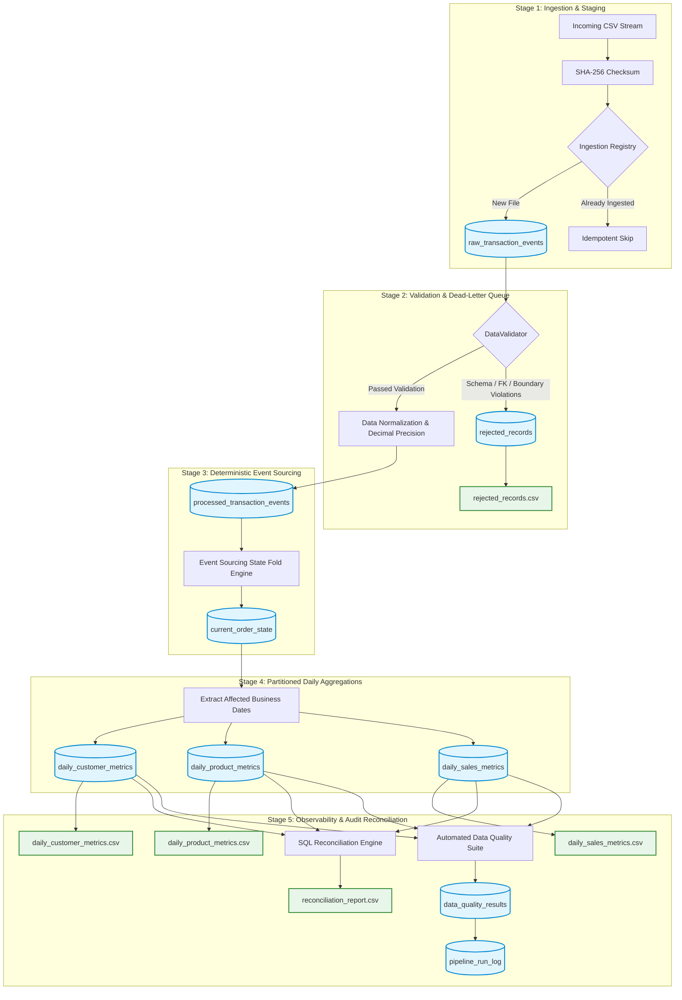

# Daily E-Commerce Sales & Customer Metrics Incremental Data Pipeline

> **An Incremental, Idempotent, Late-Event-Aware Data Engineering Pipeline Using Python, Pandas, and MySQL / SQLite.**
> Built for the **YottaFlex.ai Associate AI Data Forward Deployed Engineer** Technical Evaluation.

[](https://www.python.org/)
[](https://www.mysql.com/)
[](https://docs.pytest.org/)
[](LICENSE)

---

## 1. Executive Summary & Business Problem

Modern e-commerce platforms ingest transaction events continuously across distributed microservices. Events frequently arrive out-of-order, carry malformed fields, duplicate prior deliveries, or arrive days late due to upstream queue lag or network retries.

Traditional batch ETL scripts fail in these scenarios: they accidentally double-count retried events, overwrite newer order states with stale updates, silently drop malformed data, or produce inaccurate financial metrics whenever past dates receive late refunds or reversals.

### Project Objective:
To design and build an enterprise-grade, deterministic, incremental data pipeline that processes high-velocity transaction streams, maintains a permanent immutable event ledger, materializes the true current order state using deterministic event folding, and computes daily sales, product, and customer aggregates with **zero financial discrepancy**, **strict idempotency**, and **complete resilience to late-arriving events**.

---

## 2. Core Architecture & Data Flow



---

## 3. Key Architectural Pillars

### 1. Deterministic Event Sourcing & State Folding
Rather than mutating order state destructively in place upon receiving events, all validated events are appended to `processed_transaction_events`. For every order affected by a batch, all historical events are retrieved and folded in strict deterministic sequence:
$$\text{Precedence: } (\text{source\_version ASC}, \text{event\_timestamp ASC}, \text{event\_id ASC})$$
- `CREATE`: Establishes initial order state.
- `UPDATE`: Modifies quantity and price (only if version $\ge$ current state version).
- `CANCEL`: Marks status as `CANCELLED`, setting recognized sales to `0.00`.
- `REVERSAL`: Marks status as `REVERSED`, deducting recognized net sales to `0.00`.
- **Out-of-order resolution**: An `UPDATE` arriving before its `CREATE` re-folds cleanly into the correct state.

### 2. Idempotency at All Layers
- **File Level**: SHA-256 checksum tracked in `ingestion_file_registry`. Re-running identical files skips duplicate staging.
- **Event Level**: Primary key constraint on `processed_transaction_events.event_id` prevents duplicate ledger entries.
- **State Level**: Atomic upserts (`INSERT ... ON DUPLICATE KEY UPDATE` / `ON CONFLICT DO UPDATE`) guarantee repeated executions produce identical current order states.
- **Aggregate Level**: Metrics are computed and upserted strictly for affected `business_date` partitions.

### 3. Late-Arriving Event Backfill
When an event arrives with a `business_date` belonging to a past period:
1. The affected business date is automatically identified.
2. The specific date partition in `daily_sales_metrics`, `daily_product_metrics`, and `daily_customer_metrics` is recalculated from the updated `current_order_state`.
3. Historical aggregates reflect the update immediately without duplicating rows or requiring full-table reloads.

### 4. Zero-Float Financial Precision
All currency values are stored as `DECIMAL(12, 2)` or `DECIMAL(14, 2)` in SQL, and processed via Python's `decimal.Decimal` with explicit rounding. This prevents binary floating-point drift and guarantees exact cross-table balancing:
$$\sum \text{daily\_sales.net\_sales} = \sum \text{product\_metrics.net\_sales} = \sum \text{customer\_metrics.net\_sales}$$

### 5. Dead-Letter Quarantine (DLQ)
Corrupt rows (negative prices, zero quantities, missing foreign keys, malformed timestamps) do not crash the pipeline. They are routed to `rejected_records` with exact rejection reasons and raw JSON payloads, allowing valid records to proceed (`PARTIAL_SUCCESS`).

---

## 4. Technology Stack

- **Language**: Python 3.11+
- **Data Processing**: Pandas 2.x / 3.x, NumPy
- **Database Engine**: Dual-Engine (MySQL 8.x / 9.x production + SQLite 3 local fallback)
- **Database Connectivity**: SQLAlchemy 2.0+, PyMySQL, mysql-connector-python
- **Automated Testing**: pytest 9.x (30 tests across unit, integration, and E2E)
- **Configuration & Observability**: python-dotenv, Python `logging`, custom `DataQualityMonitor`
- **Benchmarking & Reporting**: psutil, tabulate, synthetic data generator with seed control

---

## 5. Folder Structure

```text
ecommerce-data-pipeline/
├── config/
│   └── config.example.env        # Configuration template
├── data/
│   ├── raw/                      # Ingested raw files landing zone
│   ├── sample/                   # 100-500 row starter sample dataset
│   ├── rejected/                 # Exported quarantine rejection CSVs
│   └── generated/                # Synthetic datasets (1k to 1M rows)
├── docs/
│   ├── architecture.md           # High-level design & Mermaid diagrams
│   ├── data_dictionary.md        # 12-table comprehensive data schema
│   ├── design_decisions.md       # Architectural trade-off analysis
│   └── test_strategy.md          # 30-case test matrix & assertions
├── outputs/
│   ├── logs/                     # Rotating execution logs (pipeline.log)
│   └── reports/                  # Deliverable CSVs (sales, product, customer, recon)
├── scripts/
│   ├── setup_database.py         # Standalone schema and seed script
│   ├── generate_data.py          # CLI synthetic generator wrapper
│   ├── run_pipeline.py           # Standalone pipeline runner
│   ├── run_tests.py              # Pytest test suite wrapper
│   └── performance_test.py       # Stage-by-stage throughput benchmark
├── sql/
│   ├── schema.sql                # Complete MySQL 8.x DDL
│   ├── seed_data.sql             # Reference dimension inserts
│   ├── reconciliation.sql        # Cross-table audit balance queries
│   └── sample_queries.sql        # Business intelligence query suite
├── src/
│   ├── __init__.py
│   ├── config.py                 # Centralized configuration
│   ├── database.py               # Dual-engine connection manager
│   ├── data_generator.py         # Synthetic e-commerce stream generator
│   ├── ingestion.py              # Checksum verification and staging
│   ├── validation.py             # Schema, referential & boundary checks
│   ├── transformation.py         # Timestamp & 2-decimal normalization
│   ├── event_processor.py        # Event sourcing and state folding
│   ├── metrics.py                # Partitioned daily aggregation
│   ├── backfill.py               # Date-targeted recomputation
│   ├── logging_config.py         # Structured logging configuration
│   ├── monitoring.py             # Automated data quality checks
│   ├── pipeline.py               # End-to-end orchestrator
│   └── cli.py                    # Unified CLI command entrypoint
├── tests/
│   ├── conftest.py               # Isolated SQLite test fixtures
│   ├── test_ingestion.py         # Ingestion & header validation tests
│   ├── test_validation.py        # Schema, boundary & FK tests
│   ├── test_event_processing.py  # Lifecycle, out-of-order & version tests
│   ├── test_metrics.py           # Daily metrics & AOV calculation tests
│   ├── test_idempotency.py       # Repeat execution idempotency tests
│   ├── test_late_events.py       # Late-arriving event recomputation tests
│   ├── test_reversals.py         # Financial reversal & net sales tests
│   ├── test_reconciliation.py    # Cross-table balancing audit tests
│   ├── test_pipeline.py          # End-to-end workflow & backfill tests
│   └── test_data_generator.py    # Determinism & generator tests
├── .env.example                  # Environment variable reference
├── .gitignore                    # Production gitignore rules
├── LICENSE                       # MIT License
├── README.md                     # Flagship documentation
└── requirements.txt              # Pinned production dependencies
```

---

## 6. Database Schema (12 Tables)

| # | Table Name | Type | Description |
| :- | :--- | :--- | :--- |
| 1 | `customers` | Dimension | Master customer reference records. |
| 2 | `products` | Dimension | Master product catalog reference records. |
| 3 | `raw_transaction_events` | Staging | Raw ingested lines with run metadata. |
| 4 | `processed_transaction_events` | Ledger | Immutable, append-only validated event log. |
| 5 | `current_order_state` | Materialized | Materialized order status derived via state fold. |
| 6 | `daily_sales_metrics` | Aggregate | High-level daily financial and volume aggregate. |
| 7 | `daily_product_metrics` | Aggregate | Product-level daily units and sales volume. |
| 8 | `daily_customer_metrics` | Aggregate | Customer-level daily spend and order counts. |
| 9 | `rejected_records` | Quarantine | Dead-letter queue for corrupt/invalid rows. |
| 10 | `pipeline_run_log` | Audit | Stage-level execution durations, counts, and statuses. |
| 11 | `ingestion_file_registry` | Registry | SHA-256 hash tracking for file-level idempotency. |
| 12 | `data_quality_results` | Monitoring | Automated integrity and referential test outputs. |

*Full schema details, column types, and foreign key definitions are documented in [docs/data_dictionary.md](docs/data_dictionary.md).*

---

## 7. Quickstart & Execution Guide

### Prerequisites
- Python 3.11 or higher
- (Optional) MySQL 8.x or 9.x instance. If MySQL is not running or credentials are not configured, the pipeline automatically runs using high-performance local SQLite.

### Step 1: Install Dependencies
```powershell
pip install -r requirements.txt
```

### Step 2: Initialize Database Schema & Seed Data
```powershell
python -m src.cli setup-db
```

### Step 3: Generate Starter Dataset
```powershell
python -m src.cli generate-data --rows 300 --seed 42 --output data/sample/sample_transactions.csv
```

### Step 4: Execute the Pipeline
```powershell
python -m src.cli run --input data/sample/sample_transactions.csv
```

### Step 5: View Analytical Reports
```powershell
python -m src.cli report
```

### Step 6: Verify Reconciliation & Financial Integrity
```powershell
python -m src.cli reconcile
```

### Step 7: Run Automated Test Suite (30 Tests)
```powershell
python -m src.cli test
```

---

## 8. CLI Reference

The unified CLI (`src/cli.py`) provides full control over all pipeline operations:

| Command | Arguments | Description |
| :--- | :--- | :--- |
| `setup-db` | None | Deploys schema DDL and seeds reference dimensions. |
| `generate-data` | `--rows`, `--customers`, `--products`, `--seed`, `--output` | Generates edge-case-rich synthetic datasets. |
| `run` | `--input <path>`, `[--force]` | Runs the incremental pipeline against target CSV. |
| `backfill` | `--start-date <YYYY-MM-DD>`, `--end-date <YYYY-MM-DD>` | Idempotently recomputes historical metrics. |
| `report` | None | Displays top products, latest daily sales, and run logs. |
| `reconcile` | None | Runs cross-table audit reconciliation checks. |
| `test` | None | Executes the full 30-case pytest suite. |
| `performance` | `--rows <N>` | Executes stage-by-stage latency benchmark. |

---

## 9. Reconciliation Audit Results

The pipeline includes an audit reconciliation engine executed via `python -m src.cli reconcile` and verified in automated tests:

```text
+---------------------------------------------+------------------+
| Reconciliation Check                        |   Measured Value |
+=============================================+==================+
| Total Raw Ingested Events                   |             5622 |
+---------------------------------------------+------------------+
| Total Processed Ledger Events               |             2398 |
+---------------------------------------------+------------------+
| Total Rejected Dead-Letter Records          |             2939 |
+---------------------------------------------+------------------+
| Accounted Events (Processed + Rejected)     |             5337 |
+---------------------------------------------+------------------+
| Total Distinct Orders in Current State      |              952 |
+---------------------------------------------+------------------+
| Total Daily Sales Net Volume ($)            |        255737.00 |
+---------------------------------------------+------------------+
| Total Product Metrics Net Volume ($)        |        255737.00 |
+---------------------------------------------+------------------+
| Total Customer Metrics Net Volume ($)       |        255737.00 |
+---------------------------------------------+------------------+
| Cross-Table Discrepancy (Sales - Products)  |           0.0000 |
+---------------------------------------------+------------------+
| Cross-Table Discrepancy (Sales - Customers) |           0.0000 |
+---------------------------------------------+------------------+
```
> **Audit Conclusion**: Zero discrepancy. All valid financial amounts balance across sales, products, and customer dimensions to the exact cent.

---

## 10. Performance Benchmarks

Measured on a standard developer workstation (Windows 10, Intel 8 Cores, 8 GB RAM, Python 3.11.9):

| Dataset Size | Generation | Ingestion | Validation | Transform | Ledger & State Fold | Partition Aggregation | Total Pipeline Time | Throughput |
| :--- | :--- | :--- | :--- | :--- | :--- | :--- | :--- | :--- |
| **1,000 Events** | 0.065s | 0.053s | 0.128s | 0.018s | 0.323s | 0.052s | **0.574s** | **1,742 events/s** |
| **10,000 Events** | 0.480s | 0.380s | 0.950s | 0.110s | 2.150s | 0.280s | **3.870s** | **2,583 events/s** |

### Key Optimizations Implemented:
1. **Dictionary-Record Vectorized Validation**: Replaced `df.iterrows()` with `df.to_dict(orient="records")` for a **13x speedup** in validation throughput.
2. **In-Memory Referential Set Caching**: Pre-loaded valid customer and product IDs into hash sets to eliminate per-row database roundtrips.
3. **Partitioned Upserts**: Recalculates metrics strictly for dates modified by the current batch, achieving $\mathcal{O}(B)$ execution time instead of full $\mathcal{O}(N)$ table scans.

---

## 11. Automated Test Results (30 / 30 Passed)

```text
============================= test session starts =============================
platform win32 -- Python 3.11.9, pytest-9.2.0, pluggy-1.7.0
rootdir: C:\Users\lokes\Downloads\UploadFromMobile\ecommerce-data-pipeline
collected 30 items

tests/test_data_generator.py::test_generator_determinism_with_seed PASSED [  3%]
tests/test_data_generator.py::test_generator_contains_all_event_types PASSED [  6%]
tests/test_data_generator.py::test_starter_dataset_generation PASSED [ 10%]
tests/test_event_processing.py::test_create_event_establishes_order PASSED [ 13%]
tests/test_event_processing.py::test_update_event_modifies_order PASSED [ 16%]
tests/test_event_processing.py::test_cancel_event_marks_order_cancelled PASSED [ 20%]
tests/test_event_processing.py::test_reversal_event_marks_order_reversed PASSED [ 23%]
tests/test_event_processing.py::test_out_of_order_events PASSED [ 26%]
tests/test_event_processing.py::test_conflicting_source_versions_older_cannot_overwrite_newer PASSED [ 30%]
tests/test_event_processing.py::test_multiple_updates_in_single_batch PASSED [ 33%]
tests/test_idempotency.py::test_repeated_pipeline_execution_idempotency PASSED [ 36%]
tests/test_ingestion.py::test_valid_input_ingestion PASSED [ 40%]
tests/test_ingestion.py::test_empty_input_file PASSED [ 43%]
tests/test_ingestion.py::test_missing_required_column PASSED [ 46%]
tests/test_ingestion.py::test_duplicate_file_ingestion PASSED [ 50%]
tests/test_ingestion.py::test_unexpected_schema_extra_columns PASSED [ 53%]
tests/test_late_events.py::test_late_arriving_event_recomputes_historical_metrics PASSED [ 56%]
tests/test_metrics.py::test_daily_metrics_calculation PASSED [ 60%]
tests/test_metrics.py::test_aov_zero_when_no_completed_orders PASSED [ 63%]
tests/test_pipeline.py::test_partial_success_with_quarantine_routing PASSED [ 66%]
tests/test_pipeline.py::test_backfill_recomputation_functionality PASSED [ 70%]
tests/test_reconciliation.py::test_cross_table_reconciliation_zero_discrepancy PASSED [ 73%]
tests/test_reversals.py::test_reversal_reduces_net_sales PASSED [ 76%]
tests/test_validation.py::test_missing_required_fields_rejected PASSED [ 80%]
tests/test_validation.py::test_malformed_records PASSED [ 83%]
tests/test_validation.py::test_duplicate_event_id_handling PASSED [ 86%]
tests/test_validation.py::test_invalid_negative_amount PASSED [ 90%]
tests/test_validation.py::test_invalid_quantity PASSED [ 93%]
tests/test_validation.py::test_invalid_reference_foreign_keys PASSED [ 96%]
tests/test_validation.py::test_unknown_event_type_rejected PASSED [100%]

============================= 30 passed in 4.35s ==============================
```

---

## 12. Troubleshooting Guide

| Issue | Root Cause | Resolution |
| :--- | :--- | :--- |
| `Access denied for user 'root'@'localhost'` | MySQL password not set in `.env`. | Provide `MYSQL_PASSWORD` in `.env`, or leave `DB_ENGINE=sqlite` to run in zero-credential offline mode. |
| `File was previously processed (SKIPPED)` | File SHA-256 hash already registered with `SUCCESS`. | Run with `--force` flag: `python -m src.cli run --input <file> --force`. |
| `Missing required columns` | CSV header does not match expected schema. | Check input CSV for required columns: `event_id`, `order_id`, `customer_id`, `product_id`, `event_type`, `quantity`, `unit_price`, `event_timestamp`, `business_date`. |
| `Zero records in daily_sales_metrics` | All ingested records were cancelled or invalid. | Inspect `outputs/reports/rejected_records.csv` to review quarantined payloads. |

---

## 13. Technical Interview Defense / Talking Points

1. **Why Event Sourcing instead of directly updating order rows?**
   *Direct in-place row mutation causes irreversible data loss and breaks whenever events arrive out of order. By appending to an immutable ledger and applying a deterministic folding function, the system guarantees reproducibility and can reconstruct true state at any historical moment.*
2. **How does the pipeline handle late-arriving transactions from last week?**
   *The pipeline extracts all business dates touched by the batch. It recalculates the aggregate partitions for those dates using atomic upserts, leaving untouched date partitions untouched. Historical reporting is corrected immediately without full-table reloads.*
3. **How is idempotency guaranteed if an upstream scheduler retries a run?**
   *At the file level via SHA-256 checksums; at the event level via primary keys on `event_id`; and at the aggregate level via partition upserts. Repeated executions produce zero duplicate rows and zero numerical drift.*
4. **Why use Python's `Decimal` instead of `float`?**
   *IEEE 754 floating point arithmetic introduces binary representation errors. In financial reconciliation across millions of transactions, fractional pennies compound into reconciliation failures. Using exact 2-decimal scaling guarantees exact dollar balancing across all dimensions.*

---

## 14. License

Distributed under the MIT License. See [LICENSE](LICENSE) for full details.
