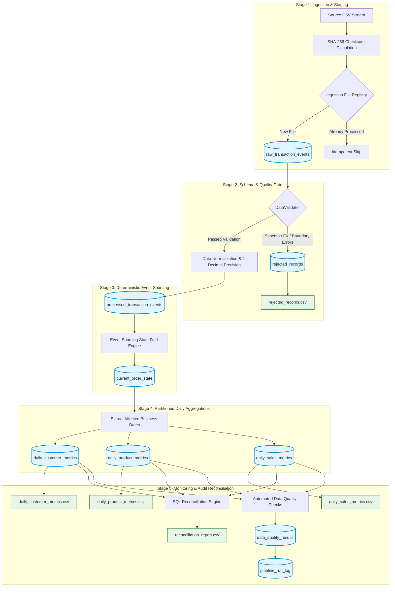

# Architectural Specification: Incremental E-Commerce Data Pipeline

## 1. System Overview

The **Daily E-Commerce Sales and Customer Metrics Incremental Data Pipeline** is an event-driven, idempotent, late-event-aware data processing system designed to ingest high-velocity transaction streams, reify current order state using deterministic event sourcing, and maintain consistent daily financial aggregations across sales, products, and customer dimensions.

The system is built on a **Dual-Engine Architecture**:
1. **Production Engine**: MySQL 8.x / 9.x (`InnoDB`, `utf8mb4`, strict ACID transactions, foreign keys, partition-level indexes).
2. **Local / Offline Engine**: SQLite 3 (`WAL` mode, foreign key enforcement enabled) providing zero-dependency local execution, reproducible automated testing, and offline resilience.

---

## 2. End-to-End Architecture Diagram

---

## 3. Data Processing Stages

### Stage 1: Ingestion & Checksum Registry
- Reads incoming CSV event files.
- Computes SHA-256 content hashes to detect duplicate files upfront before applying transformations.
- Persists raw payloads into `raw_transaction_events` with execution metadata (`run_id`, `ingested_at`, `source_file`).

### Stage 2: Validation & Dead-Letter Quarantine
- Schema verification (required columns, datetime formatting, positive integers for quantity, non-negative decimals for unit price).
- Referential integrity verification against cached master customer and product dimensions.
- Duplicate event ID detection both within the current batch and against the historical `processed_transaction_events` ledger.
- Non-conforming rows are routed to `rejected_records` with failure rationale and verbatim JSON payloads.

### Stage 3: Deterministic Event Sourcing & State Fold
- Events are appended to `processed_transaction_events` (immutable append-only ledger).
- For every `order_id` in the batch, historical events are retrieved and folded in deterministic order:
  $$\text{Precedence: } (\text{source\_version ASC}, \text{event\_timestamp ASC}, \text{event\_id ASC})$$
- Order states are upserted into `current_order_state`:
  - `CREATE`: Initializes order with active status.
  - `UPDATE`: Modifies quantity, unit price, and total amount.
  - `CANCEL`: Marks order `CANCELLED`, setting recognized sales to `0.00`.
  - `REVERSAL`: Marks order `REVERSED`, reducing recognized net sales to `0.00`.

### Stage 4: Partition-Level Incremental Aggregation
- Identifies all `business_date`s touched by the batch (including late-arriving events backdating to previous dates).
- Performs partition-level recomputations for touched dates:
  - `daily_sales_metrics`: Gross sales, net sales, completed orders, cancelled orders, distinct customers, average order value (AOV).
  - `daily_product_metrics`: Units sold, gross sales, net sales, order counts per product.
  - `daily_customer_metrics`: Units purchased, gross sales, net sales, order counts per customer.
- Updates target rows using atomic upserts (`INSERT ... ON DUPLICATE KEY UPDATE` in MySQL / `ON CONFLICT DO UPDATE` in SQLite).

### Stage 5: Automated Quality Verification & Observability
- Runs automated data quality rules on the database:
  - Uniqueness check on `processed_transaction_events.event_id`.
  - Customer referential integrity.
  - Product referential integrity.
  - Boundary integrity (no negative financial amounts).
  - Cross-table reconciliation ($$\sum \text{daily\_sales.net\_sales} = \sum \text{product\_metrics.net\_sales} = \sum \text{customer\_metrics.net\_sales}$$).
- Logs execution telemetry to `pipeline_run_log`.
- Exports deliverables to `outputs/reports/`.
